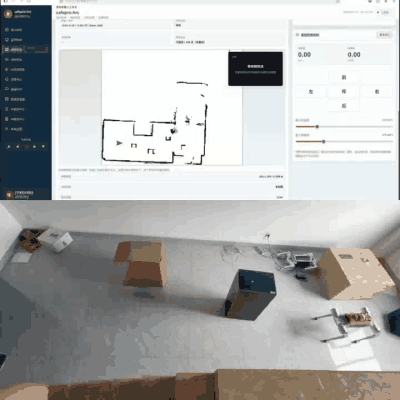

# BPX Quadruped ROS 2 Navigation Integration

**MAI Yunxi** | ROS 2 Humble | BPX quadruped | LiDAR SLAM | Nav2 | Real-robot debugging

An engineering portfolio for turning a vendor quadruped SDK into standard ROS 2 navigation interfaces. The work focuses on command safety, TF ownership, selectable odometry, SLAM/Nav2 integration and evidence-bounded hardware debugging.

[](docs/media/bpx_physical_demo.mp4)

**[Open/download the 21-second H.264 recording](docs/media/bpx_physical_demo.mp4)**.

The recording shows a physical robot, map view and control console in one integration session. It is functional evidence, not an independent measurement of localisation accuracy, route success or collision-free autonomy.

## My Contribution

- Adapted the BPX SDK to ROS 2 topics, services and velocity control, including stand-state gating and stale-command timeout: [`bpx_driver_node.cpp`](src/bpx_driver/src/bpx_driver_node.cpp).
- Implemented configurable BPX odometry and IMU publication, with explicit TF ownership controls: [driver configuration](src/bpx_driver/config/bpx_params.yaml) and [driver launch](src/bpx_driver/launch/bpx_driver.launch.py).
- Added a standard `robot_localization` EKF route without representing it as a custom estimator: [EKF launch](src/bpx_ekf_bringup/launch/ekf_localization.launch.py) and [configuration](src/bpx_ekf_bringup/config/ekf.yaml).
- Integrated `bpx`, `ekf` and `rf2o` odometry choices with SLAM Toolbox/Cartographer and Nav2: [SLAM Toolbox bring-up](src/slam_toolbox_nav2/launch/bringup.launch.py) and [Cartographer bring-up](src/cartographer_nav2/launch/bringup.launch.py).
- Reorganised the navigation subsystem into a reviewable portfolio with source attribution, failure analysis and a reproducible benchmark plan.

## System Architecture

```mermaid
flowchart LR
    SDK[BPX vendor SDK] --> DRIVER[bpx_driver]
    DRIVER --> ODOM[BPX odometry]
    DRIVER --> IMU[/imu/data]
    LIDAR[SLAMTEC LiDAR] --> SCAN[/scan]
    ODOM --> EKF[robot_localization EKF]
    IMU --> EKF
    SCAN --> RF2O[RF2O scan odometry]
    ODOM --> SELECT{odom_source}
    EKF --> SELECT
    RF2O --> SELECT
    SELECT --> SLAM[SLAM Toolbox / Cartographer]
    SLAM --> NAV2[Nav2]
    NAV2 --> CMD[/cmd_vel]
    CMD --> DRIVER
```

Each odometry mode assigns exactly one owner to `odom -> base_link`. The launch design avoids running driver TF, EKF TF and RF2O TF as competing publishers.

## Engineering Decisions

| Decision | Reason | Evidence |
| --- | --- | --- |
| Gate velocity on stand state | Rejects navigation commands before the platform is ready | [Driver callbacks](src/bpx_driver/src/bpx_driver_node.cpp) |
| Stop on stale `/cmd_vel` | Bounds continued motion after an upstream failure | [Driver timeout](src/bpx_driver/src/bpx_driver_node.cpp) |
| Select one odometry backend | Makes TF ownership explicit and supports controlled comparison | [SLAM bring-up](src/slam_toolbox_nav2/launch/bringup.launch.py) |
| Keep EKF terminology precise | The repository configures `robot_localization`; it does not contain a custom 15-state ESKF | [Evidence register](docs/evaluation.md) |
| Separate demo from benchmark | A screen recording cannot establish trajectory error or success rate | [Evaluation protocol](docs/evaluation.md) |

## Evidence and Limits

| Claim | Status |
| --- | --- |
| BPX ROS 2 interface and safety gates | Supported by source code |
| Selectable BPX/EKF/RF2O routes | Supported by launch/configuration |
| SLAM Toolbox, Cartographer and Nav2 integration | Supported by packages, maps and runbook |
| Real-platform integration session | Supported by labelled video |
| Localisation RMSE or repeated-route success rate | Not established in this repository |
| Custom 15-state legged-robot ESKF | Not claimed; absent from this repository |

The next valid result is a fixed-route comparison of the three odometry modes using rosbag2 plus an independent trajectory reference. Metrics and failure reporting are defined in [`docs/evaluation.md`](docs/evaluation.md).

## Minimal Reproduction

Target environment: Ubuntu 22.04 and ROS 2 Humble. Hardware execution requires the BPX robot and a vendor-compatible SDK.

```bash
git clone https://github.com/maiyunxi173-afk/bpx-robot-ros2-navigation-portfolio.git
cd bpx-robot-ros2-navigation-portfolio
source /opt/ros/humble/setup.bash
rosdep install --from-paths src --ignore-src -r -y
colcon build --symlink-install
source install/setup.bash
```

Start the fused-odometry path:

```bash
ros2 launch bpx_ekf_bringup ekf_localization.launch.py robot_ip:=10.21.20.1
```

Start SLAM Toolbox with the EKF route:

```bash
ros2 launch slam_toolbox_nav2 bringup.launch.py mode:=slam odom_source:=ekf
```

Hardware operation, map saving, Cartographer and TF checks are documented in the [runbook](docs/runbook.md). Run the dependency-free portfolio validation, then the Pillow-based media check:

```bash
python3 scripts/validate_portfolio.py
python3 -m pip install pillow
python3 scripts/check_media.py
```

## Scope and Attribution

This portfolio was extracted from the collaborative [Hrs_Web_Console](https://github.com/Master-Wei1201/Hrs_Web_Console) navigation workspace at source commit `ac603b8`. The web console, Android client and collaborators' work are not presented as my individual contribution.

Vendored `sllidar_ros2` and `rf2o_laser_odometry` remain third-party work, and BPX SDK headers/binaries remain subject to vendor terms. See [the complete attribution](docs/source_attribution.md) before reuse or redistribution.

## Review Paths

- [Build and experiment runbook](docs/runbook.md)
- [Evidence, failures and benchmark protocol](docs/evaluation.md)
- [Programming statement](docs/programming_statement.md)
- [Source and license attribution](docs/source_attribution.md)
- [Public-release checklist](docs/security_and_release.md)
- [Demo timecodes and evidence boundary](docs/demo_notes.md)

**Contact:** [MAI Yunxi](https://github.com/maiyunxi173-afk)
