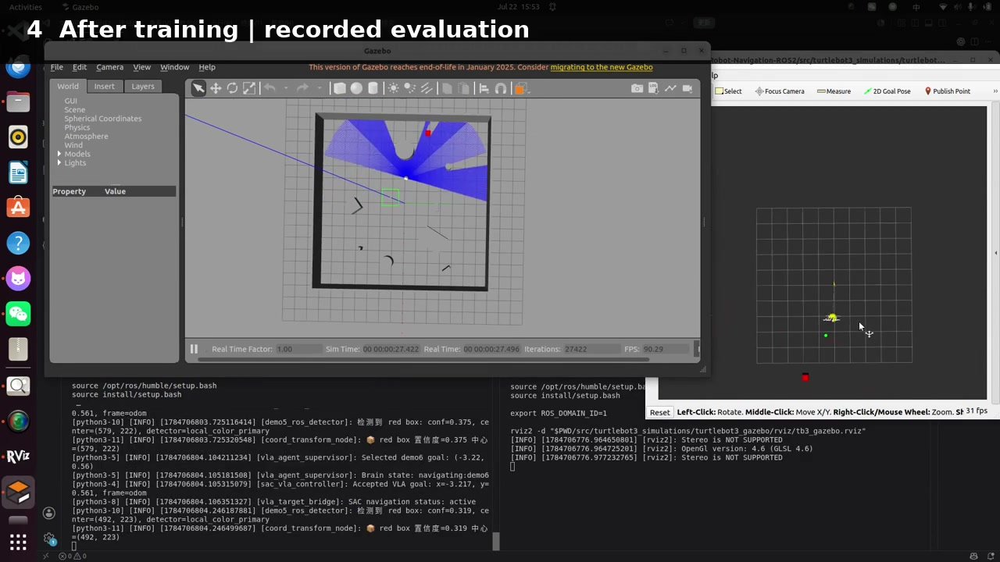
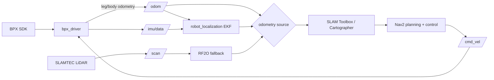

# BPX Quadruped ROS 2 Navigation

> A reviewable engineering portfolio for quadruped localisation, LiDAR SLAM and autonomous navigation.

[](https://docs.ros.org/en/humble/)
[](#system-scope)
[](docs/source_attribution.md)

This repository isolates my ROS 2 navigation contribution from a collaborative robot-console project. It turns a BPX quadruped SDK into standard ROS interfaces, provides three selectable odometry paths, and connects the robot to SLAM Toolbox, Cartographer and Nav2. The emphasis is not a single algorithm demo, but the integration decisions that make localisation and navigation components work together on a physical platform.

## 60-second overview

| Question | Answer |
| --- | --- |
| What did I build? | The BPX ROS 2 driver adaptation, odometry interfaces, EKF bring-up, SLAM/Nav2 launch integration and real-platform debugging workflow. |
| What problem does it solve? | It gives a quadruped a consistent `map -> odom -> base_link` frame chain and standard `/scan`, `/odom`, `/imu/data` and `/cmd_vel` interfaces for mapping and navigation. |
| What can be compared? | Direct BPX leg/body odometry, `robot_localization` EKF fusion, and RF2O scan-matching odometry; SLAM Toolbox and Cartographer mapping/localisation routes. |
| What evidence is included? | Source code, launch/configuration files, saved maps, run instructions, architecture documentation, and a separately labelled learning-navigation simulation demo. |

## Demo

[](assets/demo/autonomous_navigation_portfolio_demo.mp4)

**[Watch/download the 78-second edited demo](assets/demo/autonomous_navigation_portfolio_demo.mp4)** · [Demo scope and timeline](docs/demo_notes.md)

The video is a **Gazebo learning-navigation experiment**, not footage of the BPX robot. It is included as related work on learned local navigation and is deliberately separated from the real-platform ROS 2 stack documented below. The repository currently contains the recorded experiment, not the training code; see [demo notes](docs/demo_notes.md) for the evidence boundary.

## System scope



The launch files enforce one owner for `odom -> base_link`, avoiding the duplicate-TF failure mode that commonly appears when a driver, an EKF and scan odometry are enabled together.

## Engineering contribution

- Adapted the BPX SDK into a ROS 2 driver with velocity control, stand/sit/damping services, joint states, IMU, battery/status topics and odometry.
- Added command timeout and motion-state gating so stale navigation commands or commands sent before stand-up do not continue driving the robot.
- Normalised IMU quaternion handling, frame naming and startup-yaw behaviour for downstream localisation.
- Implemented BPX odometry publication with leg-odometry preference and explicit fallbacks when SDK fields are unavailable or frozen.
- Added a `robot_localization` EKF route that fuses BPX odometry and IMU while assigning TF ownership to a single node.
- Integrated two mapping/navigation routes: SLAM Toolbox + AMCL + Nav2, and Cartographer mapping/localisation + Nav2.
- Exposed `odom_source:=bpx|ekf|rf2o` to compare platform odometry, fused odometry and LiDAR scan matching without rewriting launch files.
- Documented practical failure points: frame ownership, ROS domain consistency, LiDAR extrinsics, robot motion state and map persistence.

## Repository layout

```text
.
├── src/
│   ├── bpx_driver/              # BPX SDK bridge, safety gating, IMU and odometry
│   ├── bpx_ekf_bringup/         # robot_localization configuration and launch
│   ├── slam_toolbox_nav2/       # online mapping and AMCL/Nav2 navigation
│   ├── cartographer_nav2/       # Cartographer mapping/localisation and Nav2
│   ├── rf2o_laser_odometry/     # third-party scan-matching fallback
│   └── sllidar_ros2/            # third-party SLAMTEC LiDAR driver
├── assets/
│   ├── demo/                    # edited application demo and cover image
│   └── diagrams/
├── docs/
│   ├── project_showcase.md      # extended technical narrative
│   ├── runbook.md               # build, launch and validation commands
│   ├── demo_notes.md            # video timeline and evidence boundary
│   └── source_attribution.md    # collaboration and third-party attribution
└── scripts/build_portfolio_demo.sh
```

## Quick start

Tested target environment: Ubuntu 22.04 and ROS 2 Humble. A BPX robot and its vendor SDK are required for hardware execution.

```bash
sudo apt install \
  ros-humble-navigation2 ros-humble-nav2-bringup \
  ros-humble-slam-toolbox ros-humble-robot-localization \
  ros-humble-cartographer-ros

colcon build --symlink-install
source install/setup.bash
```

Start the driver and fused odometry:

```bash
ros2 launch bpx_ekf_bringup ekf_localization.launch.py \
  robot_ip:=10.21.20.1
```

Start SLAM Toolbox mapping:

```bash
ros2 launch slam_toolbox_nav2 bringup.launch.py \
  mode:=slam odom_source:=ekf
```

Navigate on a saved map:

```bash
ros2 launch slam_toolbox_nav2 bringup.launch.py \
  mode:=nav \
  map:=src/slam_toolbox_nav2/maps/my_map.yaml \
  odom_source:=ekf
```

For Cartographer, RF2O fallback, frame checks and map saving, follow the [runbook](docs/runbook.md).

## Design decisions

| Decision | Rationale |
| --- | --- |
| One TF publisher per odometry mode | Prevents competing `odom -> base_link` transforms and unstable localisation. |
| Selectable odometry backend | Keeps navigation testable when quadruped leg/body odometry degrades or is unavailable. |
| Velocity-command timeout | Stops motion if the upstream controller stops publishing. |
| Stand-state gate | Rejects navigation velocity until the BPX platform reports its standing state. |
| Separate simulation evidence | Makes clear which results are Gazebo demonstrations and which components belong to the BPX integration. |

## Evidence status and limitations

- Saved maps and launch/configuration artefacts are included; raw ROS bags and quantitative navigation benchmarks are not yet included.
- The EKF in this repository is configured through the standard `robot_localization` package. A separate custom 15-state error-state estimator mentioned in my broader application materials is **not represented by code here** and is therefore not claimed as part of this repository.
- BPX vendor SDK headers and binaries are retained under `src/bpx_driver/third_party/bpx_sdk`; redistribution and hardware compatibility should be checked against the vendor terms before reuse.
- The edited learning-navigation video is simulation evidence only. No claim of real-robot deployment is made for that policy.

## Collaboration and attribution

The navigation workspace was extracted and reorganised from the collaborative [Hrs_Web_Console](https://github.com/Master-Wei1201/Hrs_Web_Console) repository at source commit `ac603b8`. My portfolio scope is the BPX ROS 2 navigation subsystem described above; the web console and other collaborators' work remain attributed to the source project. Third-party packages are identified in [source attribution](docs/source_attribution.md).

## Documentation

- [Technical project showcase](docs/project_showcase.md)
- [Build and experiment runbook](docs/runbook.md)
- [Demo notes and timecodes](docs/demo_notes.md)
- [Source and third-party attribution](docs/source_attribution.md)

## Contact

**Mai Yunxi** · [maiyunxi173@gmail.com](mailto:maiyunxi173@gmail.com) · [GitHub profile](https://github.com/maiyunxi173-afk)
