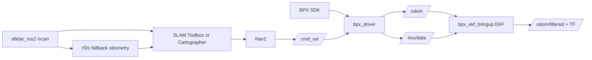

# BPX ROS 2 Navigation Portfolio

## Project Positioning

This repository extracts and reorganizes my ROS 2 navigation contribution from the collaborative HRS Web Console project into a standalone, reviewable portfolio. The focus is the BPX quadruped navigation stack: robot driver integration, odometry output, EKF localisation bring-up, LiDAR SLAM mapping, and Nav2 navigation on a physical platform.

## My Contribution

- Integrated the BPX robot SDK into a ROS2 driver node with `/cmd_vel` control, stand/sit/damping services, status topics, IMU output, joint states, battery state, and odometry publication.
- Built the odometry interface used by navigation, including BPX SDK leg/body odometry output and a switchable rf2o LiDAR odometry fallback.
- Added an EKF bringup layer using `robot_localization` to fuse BPX odometry with IMU attitude/angular velocity for a stable `odom -> base_link` transform.
- Reorganized two SLAM/navigation routes: `slam_toolbox` mapping + AMCL/Nav2 navigation, and Cartographer mapping/localization + Nav2 navigation.
- Tuned launch files and Nav2 parameter wiring so mapping, localization, and navigation can be started through simple mode arguments.
- Debugged real-robot integration details: TF ownership, ROS domain consistency, robot motion state gating, LiDAR frame alignment, and map persistence.

## Repository Structure

```text
.
├── src/
│   ├── bpx_driver/              # BPX SDK bridge, command, status, IMU, joints, odom
│   ├── bpx_ekf_bringup/         # robot_localization EKF configuration and launch
│   ├── sllidar_ros2/            # SLAMTEC/RPLIDAR scan driver
│   ├── rf2o_laser_odometry/     # scan-matching odometry fallback
│   ├── slam_toolbox_nav2/       # slam_toolbox mapping + AMCL/Nav2 navigation
│   └── cartographer_nav2/       # Cartographer mapping/localization + Nav2 navigation
├── docs/
│   ├── project_showcase.md
│   └── runbook.md
└── assets/
    └── diagrams/system_architecture.mmd
```

## System Flow



## Technical Highlights

### ROS2 Driver and Odometry

`bpx_driver` converts the BPX SDK into ROS2-native interfaces. It publishes odometry, cleaned IMU data, joint states, raw EKF-friendly streams, and robot status topics while exposing stand-up, sit-down, and damping services. The driver also gates velocity commands by robot motion state to prevent sending navigation velocity while the robot is not standing.

### EKF Fusion

`bpx_ekf_bringup` launches the driver with BPX odometry TF disabled, then starts `robot_localization/ekf_node`. The EKF fuses BPX odometry and IMU measurements and owns the `odom -> base_link` transform. This prevents duplicate TF publishers and gives Nav2 one consistent local frame chain.

### SLAM and Navigation

`slam_toolbox_nav2` supports online mapping and map-based navigation. `cartographer_nav2` supports Cartographer mapping, pure localisation from `.pbstream`, and Nav2 navigation with occupancy-grid maps. Both stacks accept `odom_source:=bpx|ekf|rf2o`, making the odometry path explicit and preventing competing TF publishers.

## Failure-driven integration

The main engineering value came from resolving interface failures rather than presenting a frictionless final demo. Frozen leg-odometry fields required an explicit fallback path; stale velocity commands required a timeout; motion commands had to be gated by the platform's stand state; and the driver, EKF and scan odometry could not all own `odom -> base_link`. LiDAR extrinsic differences between historical configurations also remain a calibration task before fair quantitative comparison.

These cases, their mitigations and their remaining limits are recorded in [the evidence and evaluation document](evaluation.md).

## Results boundary

The repository includes implementation, configuration, maps and simulation video evidence. It does not include a ground-truth BPX trajectory dataset, fixed-route navigation trials or a policy-deployment result. Therefore, it makes no numerical claim for BPX localisation error, navigation success rate or sim-to-real transfer. The proposed protocol for adding those results is documented rather than filling the gap with unsupported numbers.

## Evidence of Engineering Ownership

This portfolio is intentionally organized around the navigation subsystem rather than the full web console. It separates platform-specific driver code, localization bringup, SLAM packages, maps, configuration, and documentation so reviewers can understand what I built, how it runs, and which integration decisions were made for a real BPX robot.

For a concise admissions-oriented account of language proficiency and code evidence, see the [programming statement](programming_statement.md). For collaboration and third-party boundaries, see [source attribution](source_attribution.md).
